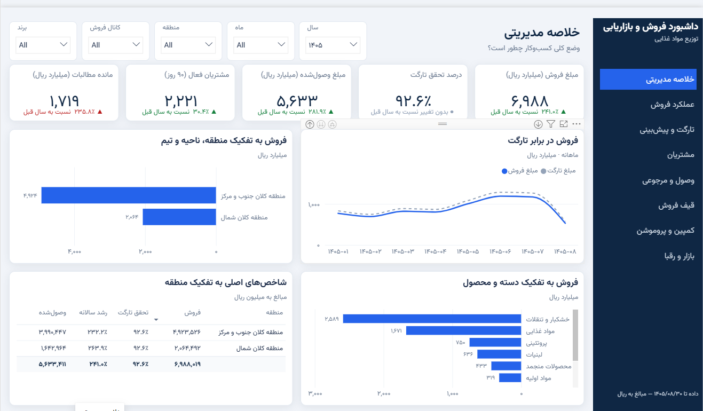

# داشبورد فروش و بازاریابی — Team-Sepasi

پروژه داشبورد بازاریابی و فروش، پخش صنایع غذایی اعتماد ایرانیان — مراحل ۹ تا ۱۳ — تحویل ۱۴۰۵/۰۹/۰۶

**اعضای تیم:** سینا سپاسی (سرگروه)، سحر سیاح، شهلا حسینی، سمانه غنی‌آبادی

## داخل این پوشه

| مسیر | محتوا |
|---|---|
| `Dashboard/Dashboard_v1.2_1405-09-06.zip` | بسته کامل داشبورد: پروژه Power BI (PBIP) همراه داده، فونت‌ها، راهنمای نصب و اجرا و یک نسخه از همه مستندات |
| `Docs/Stage09` | لایه گزارش rpt: اسکریپت ساخت ۳۸ View، اسکریپت اعتبارسنجی و نتیجه آن، مستند لایه |
| `Docs/Stage10` | فرهنگ KPI (۱۰۹ شاخص، پوشش مرحله ۳، تست‌ها)، کد DAX همه Measureها، کوئری‌های SQL تست |
| `Docs/Stage11` | طرح UI/UX داشبورد |
| `Docs/Stage13` | خلاصه پروژه، برنامه تست، راهنمای کاربر، مدل داده، راهنمای فنی، گزارش تست، محدودیت‌ها و نسخه بعد |
| `Screenshots` | تصویر هر ۱۰ صفحه داشبورد |

هر سند Word یک نسخه PDF هم دارد که همین‌جا در GitHub باز می‌شود. برای شروع `Docs/Stage13/13-00-Project-Summary.pdf` را ببینید.

## باز کردن داشبورد

1. فایل zip را دانلود و کامل Extract کنید.
2. Power BI را ببندید و همه فایل‌های پوشه `Fonts` را نصب کنید (داشبورد با فونت Vazirmatn FD ساخته شده است).
3. روی `FoodDistribution-Dashboard.pbip` دوبار کلیک کنید. داده داخل فایل است (تا ۱۴۰۵/۰۸/۳۰)؛ Refresh لازم نیست.

برای Refresh باید دیتابیس `FoodDistributionDB` نسخه ۲ و لایه rpt (`Docs/Stage09/09-01-RPT-Layer-Create.sql`) روی SQL Server باشد و پارامترهای `Server` و `Database` تنظیم شوند؛ جزئیات در `13-04-Technical-Guide`.

## وضعیت

- لایه rpt: ۳۸ View (۱۶ بعد، ۲۱ فکت، ۱ پل)؛ اعتبارسنجی ۱۶۸ PASS و ۰ FAIL.
- مدل: Star Schema با ۹۰ رابطه؛ ۱۰۹ Measure در جدول `_Measures` و ۱۰۳ Measure کمکی نمایش.
- داشبورد: ۸ صفحه اصلی و ۲ صفحه جزئیات (Drill-through مشتری و فروشنده)، فیلترهای هماهنگ بین صفحه‌ها، تقویم شمسی.
- تست: هر ۱۰۱ تست برنامه قبول؛ ۷۲ مقایسه Measure با SQL، اختلاف صفر. بازآزمایی نهایی در ۱۴۰۵/۰۹/۰۶.

## مواردی که به تصمیم یا تأیید مدیر پروژه نیاز دارد

- طرح UI/UX (سند 11-01) هنوز تأیید رسمی مدیر پروژه را ندارد.
- ۸۴ KPI از ۲۶۰ KPI مرحله ۳ پوشش داده شده است؛ بقیه به داده‌ای نیاز دارند که در مدل نیست (جزئیات در شیت «پوشش مرحله ۳» فایل 10-01).
- انتشار روی Workspace تست، زمان‌بندی Refresh و Row-Level Security انجام نشده و منتظر تصمیم است.
- سناریوهای کاربران را تیم سازنده مرور کرده است، نه کاربران نهایی؛ تأیید مالکان KPI هم گرفته نشده است.
- فهرست کامل محدودیت‌ها (L-01 تا L-16) در `13-06-Limitations-and-Next-Version` آمده است.

